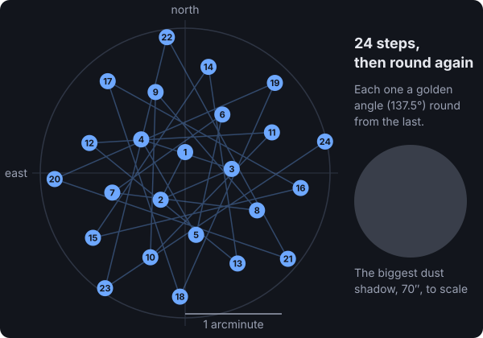

I was looking at the camera's screen while it was shooting the Triangulum Galaxy and there were dark spots in the picture. Some of them looked worse than dust. I couldn't tell if they were something wrong with the telescope or part of the galaxy.

## Dust stays put when the sky moves

There's an easy way to tell. Dust on the camera's sensor is stuck to the sensor, so it shows up in the same place in every picture no matter where the telescope points. Anything that's actually in the sky moves when the telescope moves.

We had an hour of pictures of the Dumbbell Nebula from earlier in the night, in a completely different part of the sky. Claude cropped the same four spots out of 12 pictures of each target and put them side by side.

 and 12 of the Triangulum Galaxy (right), an hour apart. The stars are different. The dark blotches are identical, so they're on the sensor.")

They're dust, and one looks like a little fiber. Measured from the pictures, they're 30 to 70 arcseconds across and they block 5 to 10 percent of the light behind them. On the camera's little screen, stretched dark, that looks a lot worse than it is.

## Why you can't fix this afterwards

The usual answer is a flat: a picture of something evenly lit that records exactly how much each spot of the sensor is dimmed, so you can divide it back out. That works, but it's never perfect, and I don't have one for tonight yet.

The problem with a telescope that holds perfectly still is that the same patch of galaxy sits behind the same speck of dust in every single picture. Stacking a hundred pictures doesn't help, because all hundred of them are dimmed in the same spot. There's no clean copy of that patch anywhere to recover it from.

So I asked Claude whether it could just move the telescope around between shots. My thinking was that it knows how big the dust is, so it should know how far it has to move to make up the difference and average it out.

That's called dithering, and it's standard practice in astrophotography. It has to happen at the telescope, because the point is that each patch of sky lands on a different part of the sensor in different pictures. Then when the stacking software lines all the pictures up on their stars, any one patch is only behind dust in a few of them, and taking the median throws those few out. It cleans up hot pixels and the faint streaky pattern that a camera's sensor adds the same way.

## How far to move, and where

The moves have to be bigger than the biggest speck of dust, otherwise the dust just lands on top of where it was. The biggest one was 70 arcseconds, so the telescope moves around inside a circle 1.5 arcminutes in radius.



The pattern isn't random. It's the same spiral a sunflower uses to pack its seeds, which spreads points evenly over a circle without any two landing close together. Because it's worked out from a formula, every picture can record exactly where it was taken, and you can check it later:

```elixir
# from Controller.Sky.Dither: the kth place to point, as arcminutes east and north of the middle.
# Each step turns a golden angle (137.5°) from the last and steps out so the disc fills evenly.
def offset(k, radius, n \\ 24) do
  i = rem(k, n)
  r = radius * :math.sqrt((i + 0.5) / n)
  a = i * 137.50776405003785 * :math.pi() / 180
  {r * :math.sin(a), r * :math.cos(a)}
end
```

The move itself works the same way centering does. The software hands the tracking a new aim, sends the mount there, and waits until tracking says it has settled before the next picture starts. It only ever moves while the shutter is closed.

## It worked, once I stopped bumping it

The first test on the real telescope went out at 1.5 arcminutes and every picture's record came back with its place in the spiral. Stars measured 5.1 to 5.8 arcseconds, as sharp as the pictures before it.

Except for one, which came out at 20 arcseconds. That one was taken while I was outside blasting the front glass with an air compressor. Claude pointed out the dust it was worried about is on the camera sensor, not the front glass, and dust on the front glass is too far out of focus to ever show up. So that did nothing except shake the telescope for one picture. I checked the glass with a flashlight afterwards. Nothing obvious.

## Moving costs time, so it moves every third picture

Each move takes about 16 seconds to make and settle. Moving before every picture stretched each 15 second picture from 34 seconds to 50, which throws away almost a third of the night's light. Moving every third picture still spreads the dust over hundreds of pictures and gives most of that time back, so that's what it does for the rest of the night.
