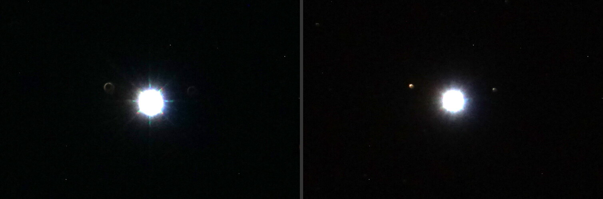

The first pictures tonight were out of focus. Not a little soft. Every star was a ring with a hole in the middle, about 12 arcseconds across. Last week the same telescope made stars 4 to 5 arcseconds wide.

Nothing in software fixes that. Claude told me as much, and I told it I could dial in focus in 45 minutes.

## Why an out-of-focus star is a donut

My telescope is a Celestron 8SE, a Schmidt-Cassegrain. Light comes in the front, bounces off a big mirror at the back, then off a small mirror stuck to the middle of the front glass, and back out through a hole in the big mirror to the camera. That small mirror blocks the middle of the light coming in.

In focus, all of that light meets at a point, so you never see the shadow. Out of focus, each star turns into a little picture of the telescope's opening, with the small mirror's shadow as the hole. The bigger the donut, the further out of focus you are.

## Measure the star, don't eyeball it

Judging focus by eye on a camera's little screen in the dark is miserable. So the software measures it. For every picture it finds the stars and, for each one, measures how wide a circle you need to hold half of that star's light. That's called the half-flux diameter. It works the same on a donut as on a point, so it always tells you how far off you are. The software takes the middle value over all the stars in the picture and shows it on the camera page as "Star size", with the last picture's number beside it.

My camera puts 0.39 arcseconds on each pixel, so a 12 arcsecond star is about 30 pixels across.

## Park on a bright star and take pictures nonstop

While I was still out, Claude pointed the telescope at Vega and set the camera taking a 2 second picture back to back, one about every 17 seconds. When I got there all I had to do was turn the knob, wait for the next picture, and look at the number.

On an 8SE the focus knob is on the back of the tube. It slides the big mirror back and forth. There's no lock and no fine adjustment, just the knob. I turned it a bit and Claude read the next pictures.

The numbers, picture by picture: 12.8, 12.2, then 4.8 and 5.2. One turn, in the right direction, and it was there.

## How small is small enough

You can't get a star down to nothing, because the air between you and the star moves around and smears it. On a typical night here that's about 4 arcseconds. Once you're at 5, more fiddling mostly chases the air. Claude's advice was to stop there rather than risk turning past it.

If you have a camera on your telescope and any software that measures star size (a lot of free capture programs do, under names like HFD or FWHM), this is the way to focus. Pick a bright star, take short pictures nonstop, and turn the knob in the direction that makes the number go down. When it starts going back up, come back half as far.
