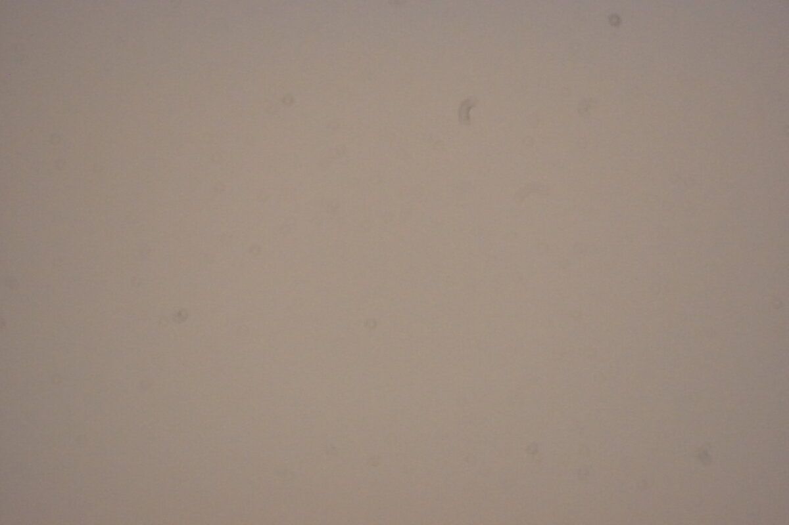

The Moon was out early tonight, a little less than half lit, hanging low in the southwest. My focus was off and I wasn't home yet, so I asked Claude whether it could plate solve the Moon and shoot it while it waited for me.

## Plate solving needs stars

Everything my telescope does to aim itself starts with plate solving. It takes a photo, finds the stars in it, and matches their pattern against a catalog of millions of stars until it knows exactly where the photo was taken. Then it compares that to where it meant to point and nudges the mount by the difference.

The Moon breaks that. It's so bright that a photo exposed for it is a fraction of a second long, 1/250 of a second at ISO 200 tonight, and a photo that short has no stars in it at all. There's nothing to match.

## It doesn't need to, because the Moon is bigger than the view

My camera on this telescope sees about two thirds of a degree by less than half a degree. The Moon is half a degree across. After a good alignment the mount points to within about an arcminute, a sixtieth of a degree, so a Go To to the Moon lands with the Moon filling the picture. From there the software can center on the bright edge of the Moon instead of on stars.

The part my software can't do yet is follow it. The Moon drifts east against the stars by about its own width every hour, so a telescope tracking the stars slowly loses it. For a few quick pictures that doesn't matter. For a mosaic of the whole Moon it would, and that's on the list.

## The first photo came back black

The Moon had already crossed the meridian, the north-south line overhead, so getting to it meant flipping the telescope over to the other side of the mount. Claude checked that the counterweight would end up below the tube, which it did, and sent it.

The first picture at Moon settings was completely black. The brightest pixel read 0 out of 255.

## A grey photo with no stars told us it was the garage

So Claude took a 2 second picture at ISO 6400, about 16,000 times more light, to see what was in front of the telescope.

The reasoning went like this. If the Moon were just outside the picture, one side of it would be much brighter than the other, because the sky right next to the Moon glows. If the telescope were looking at open sky, there would be stars. Claude measured the brightness in a three by three grid. The middle read 150 and the corners about 137, which is the normal darkening at the edges of any telescope's view. No glow from one side, no stars. That's something solid and lit, and I'd already told Claude before it tried that the garage might be in the way. The Moon was behind it and getting lower.

## A low Moon isn't worth chasing anyway

Even without the garage, it wouldn't have been a good picture. Low in the sky you're looking through several times as much air as straight up, and the air shimmers. That shimmer smears out exactly the fine detail you want from the Moon, the edges of craters and the shadows along the line between day and night. In the winter, a Moon at this phase rides high in the evening sky, and that's when I'll go after it.

So Claude gave up on the Moon and pointed the telescope at Vega instead, a bright star high in the west, so I'd have something to focus on when I got home.
